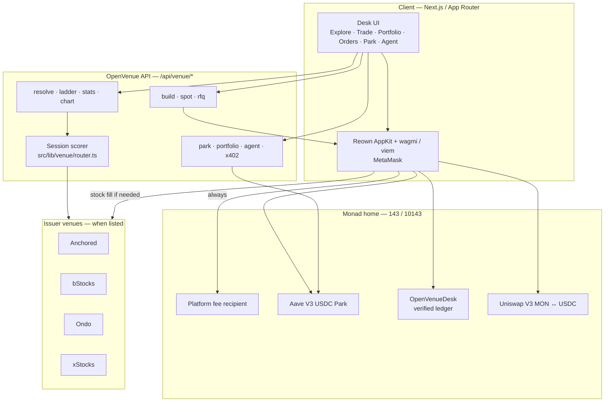
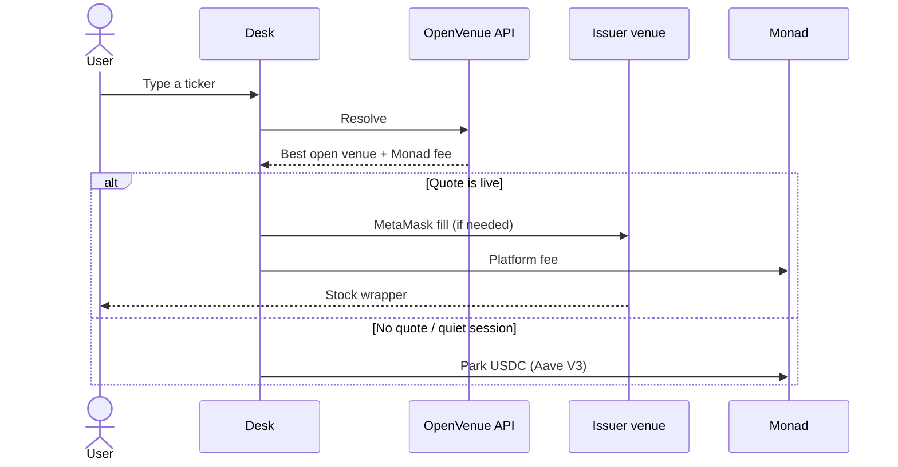
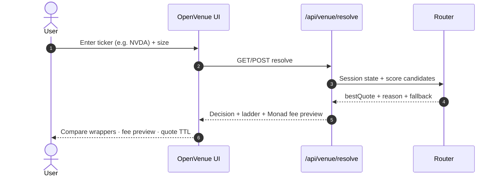
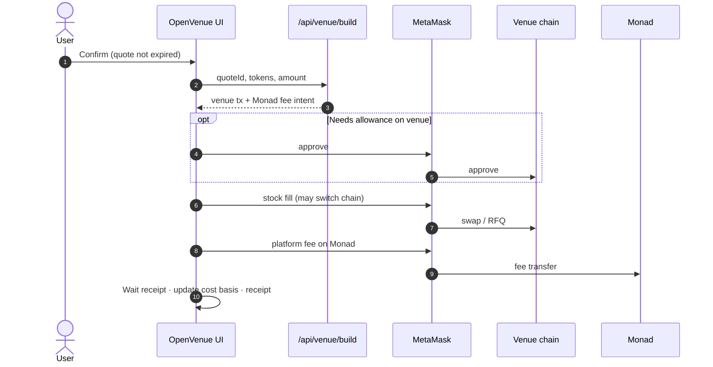
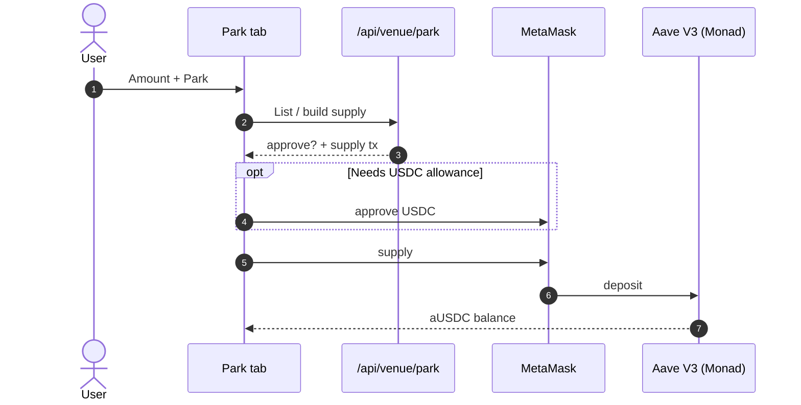
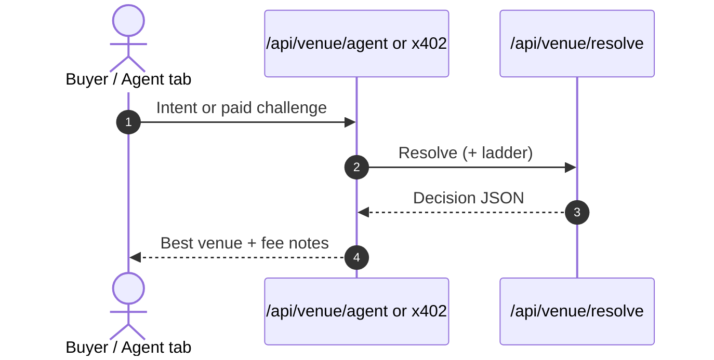

# OpenVenue

**Flight-style aggregator for tokenized stocks — home base on Monad.**

Say you want NVDA. OpenVenue compares issuer venues (**Anchored** on Monad, plus live **bStocks** / **Ondo** / **xStocks** where listed), scores the best path under US market hours, opens MetaMask for the fill, and settles **platform fees on Monad**. When equity venues are quiet, it parks idle **USDC** into **Aave V3** on Monad.


| | |
| --- | --- |
| GitHub | [github.com/AmaanSayyad/OpenVenue](https://github.com/AmaanSayyad/OpenVenue) |
| Live | [openvenue.xyz](https://openvenue.xyz) |
| Desk (mainnet) | [`0xBdb5…aD40`](https://monadvision.com/address/0xBdb5bDc633Dec3F7D288C1b93b775A80fFE1aD40) |
| Desk (testnet) | [`0xCFF0…34Fa`](https://testnet.monadvision.com/address/0xCFF046c4bCBab4f25254Fd41d94f8AcD7a3334Fa) |
| Pitch deck | [Chronicle — OpenVenue Monad](https://app.chroniclehq.com/amaan-s-workspace/openvenue-monad) |
| Demo video | [Google Drive folder](https://drive.google.com/drive/folders/1TuNcIJzfz2zBeFZEqPaOEqWkbUR-vCXw?usp=sharing) |
| Tweet | [x.com/amaanbiz/status/…](https://x.com/amaanbiz/status/2117954547817828767) |
| Blitz notes | [`docs/HACKATHON.md`](./docs/HACKATHON.md) · [`docs/DX-REPORT.md`](./docs/DX-REPORT.md) |

**Prior work (disclosed):** OpenVenue began as an earlier tokenized-stock desk prototype. For Monad Blitz the product was rewritten around Monad as home chain — fees, Park, AppKit, and OpenVenueDesk land on Monad; the compare/execute UX was carried forward and extended.

---

## What did you build?

**OpenVenue** — a session-aware tokenized stock desk whose **product surface, fees, Park, and ledger live on Monad** (Mainnet `143` / Testnet `10143`).

### What it does

- Turns a plain ticker intent (“buy NVDA”) into a **live multi-wrapper route** across Anchored, bStocks, Ondo, and xStocks.
- Scores venues using US equity market hours, spread, and fill quality; shows fee preview + quote TTL before sign.
- Executes **spot** via MetaMask — switches to the issuer venue chain when needed; **platform bps always settle on Monad**.
- Shows explore markets, charts, stats, corporate actions, Limit / TWAP, portfolio, alerts (today-only), and shareable receipts.
- Opens a **product guide** on first visit (or **Guide** in the header).
- Parks idle **USDC** into **Aave V3** on Monad (supply / withdraw from the Park tab).
- Ships a verified **OpenVenueDesk** Solidity ledger + MON fee sink on both Monad networks.
- Exposes resolve for agents via `/api/venue/agent` and a paid face at `/api/venue/x402` (~$0.05 USDC on Monad).

### Who it is for

| Who | Why |
| --- | --- |
| Crypto-native equity traders | One desk instead of three wrapper UIs |
| Session-aware / power users | Watchlist, alerts, TWAP, corporate-action banners |
| Idle USDC holders | One-tap Park on Monad Aave when markets are closed |
| Agent builders | NL agent tab + x402 resolve face on the same router |
| Blitz judges | Runnable Monad MVP + verified contracts + DX report |

Spot only. No perps. Users fund their own wallets.

### Monad surfaces

| Surface | Detail |
| --- | --- |
| **Wallet / UX** | Reown AppKit · wagmi / viem · Monad Mainnet & Testnet |
| **Fees** | Platform fee (default **15 bps**) → `NEXT_PUBLIC_PLATFORM_FEE_RECIPIENT` on Monad |
| **Park** | Aave V3 USDC supply / withdraw on Monad |
| **Spot on Monad** | Uniswap V3 MON ↔ USDC |
| **Desk contract** | `OpenVenueDesk` — Sourcify-verified on testnet + mainnet |
| **Stock fills** | MetaMask executes on the venue that actually lists the wrapper |

### Tokenized stocks it touches

Core desk tickers (explore / trade / demo):

| Underlying | Example wrappers surfaced |
| --- | --- |
| **NVDA** | NVDAB (bStock) · NVDAon (Ondo) · NVDAx (xStock) · Anchored when listed |
| **AAPL** | AAPLB / AAPLon / AAPLx |
| **TSLA** | TSLAB / TSLAon / TSLAx |
| **META** | METAB / METAon / METAx |
| **SPY** | SPYB / SPYon / SPYx |
| **AMZN, GOOGL, MSFT, AMD, NFLX** | Same `*B` / `*on` / `*x` pattern |

Resolve is ticker-generic. Primary live demo path: buy ~$15 **NVDAB** (venue fill) + fee hop on Monad; Park small USDC into Aave.

### Deployed contracts (OpenVenueDesk)

| Network | Chain ID | Address | Explorer |
| --- | --- | --- | --- |
| Monad Testnet | `10143` | `0xCFF046c4bCBab4f25254Fd41d94f8AcD7a3334Fa` | [MonadVision testnet](https://testnet.monadvision.com/address/0xCFF046c4bCBab4f25254Fd41d94f8AcD7a3334Fa) |
| Monad Mainnet | `143` | `0xBdb5bDc633Dec3F7D288C1b93b775A80fFE1aD40` | [MonadVision](https://monadvision.com/address/0xBdb5bDc633Dec3F7D288C1b93b775A80fFE1aD40) |

Source: [`contracts/src/OpenVenueDesk.sol`](./contracts/src/OpenVenueDesk.sol) · deployments: [`contracts/deployments.json`](./contracts/deployments.json)

---

## Table of contents

1. [What did you build?](#what-did-you-build)
2. [Story & inspiration](#story--inspiration)
3. [Problem](#problem)
4. [Solution](#solution)
5. [Why we built it](#why-we-built-it)
6. [Who is it for?](#who-is-it-for)
7. [Features](#features)
8. [Architecture](#architecture)
9. [Sequence diagrams](#sequence-diagrams)
10. [Core tech stack](#core-tech-stack)
11. [Business model](#business-model)
12. [Go-to-market](#go-to-market)
13. [Roadmap](#roadmap)
14. [Environment variables](#environment-variables)
15. [Run locally](#run-locally)
16. [Mainnet demo](#mainnet-demo)
17. [Scripts](#scripts)
18. [Repo map](#repo-map)
19. [Links](#links)
20. [Security](#security)
21. [License](#license)

---

## Story & inspiration

Tokenized US equities are liquid enough to trade — but they are **not one product**. The same economic exposure ships as:

| Wrapper | Typical feel |
| --- | --- |
| **bStocks** | Deep AMM / RFQ mix, familiar tickers (`NVDAB`) |
| **Ondo** | Attestation-backed (`NVDAon`), often RFQ-gated to market hours |
| **xStocks** | 24/7 AMM-first (`NVDAx`) when listed |
| **Anchored** | Multi-chain ERC-20 stocks already present on **Monad** |

Most desks force the user to pick a brand, a venue, and a mode. Ondo-style product UX (explore → asset → ticket) inspired the surface; Monad’s high-performance EVM inspired the **home chain** for fees, Park, and the desk ledger.

OpenVenue treats “buy NVDA” as **one intent** — compare venues, execute the best path, monetize on Monad.

---

## Problem

1. **Fragmented wrappers** — Same ticker, multiple platforms, different spreads, hours, and attestation stories.
2. **No Monad desk** — Monad has no first-class tokenized-stock product in the project directory; traders bounce off-chain or to other L1s.
3. **Session blindness** — RFQ that works at 10:00 ET fails after hours; AMM that looks worse at open is often the only fill at night.
4. **Quote → sign gap** — Aggregator quotes expire; users sign stale payloads or skip fee clarity.
5. **Idle capital** — When equity venues are closed or spreads blow out, cash sits with no one-tap Park on Monad.
6. **Agents need a machine face** — Bots need a priced, JSON venue recommendation, not a screenshot.

---

## Solution

**OpenVenue** is a Next.js desk + API router that:

1. Resolves a human ticker → multi-wrapper candidates (issuer registry + market data).
2. Scores candidates with a **session-aware** router (RFQ bias in US hours, AMM bias off-hours; spread penalties).
3. Quotes the route, shows **Monad fee + gas preview**, and **blocks stale execute** with a quote TTL.
4. Builds the venue tx, then signs in MetaMask (wagmi / viem) — switching chain when the fill lives off Monad.
5. Settles **platform fees on Monad** to the configured recipient; optionally notes the fill on **OpenVenueDesk**.
6. Confirms fill, updates cost basis / PnL, and issues a **shareable receipt**.
7. Falls back to **Park USDC** on Aave V3 (Monad) when equity routes fail or markets are quiet.
8. Exposes the same resolve work to the **Agent** tab and `/api/venue/x402`.

---

## Why we built it

- Tokenized stocks only win if UX feels like a **single equity product**, not three DEX tabs.
- Monad Blitz rewards a **working MVP on Monad** — OpenVenue puts fees, Park, AppKit, and a verified desk contract on-chain there, even when liquidity still lives on issuer venues.
- We wanted a path from **retail click** → **live MetaMask fill** → **Monad fee** → **Park idle USDC** on one resolve engine.

---

## Who is it for?

| Audience | What they get |
| --- | --- |
| **Crypto-native equity traders** | Explore markets, compare wrappers, one-tap best venue, portfolio + sell |
| **Session-aware power users** | Watchlist alerts (today-only), corporate-action banners, Limit / TWAP |
| **Idle-capital holders** | Park / unpark USDC on Monad Aave when venues are quiet |
| **Agent builders** | NL agent tab + x402 resolve face |
| **Blitz judges / reviewers** | Runnable Monad demo, verified contracts, DX + hackathon docs |

**Not for:** perps, leverage, custodial brokerage, or off-chain equity settlement. Spot wrappers only. Teams fund their own wallets.

---

## Features

### Desk (human UI)

| Area | Capability |
| --- | --- |
| **Explore** | Markets table, filters, gainers / trending, portfolio strip |
| **Trade** | Buy / sell ticket, wrapper compare, size ladder ($15 / $50 / $200), sticky ticket rail |
| **Quotes** | Expiry countdown, block stale execute, fee + gas + impact preview (Monad fee hop called out) |
| **Fills** | MetaMask venue execution + Monad fee settlement; cost-basis update |
| **Stats** | Token vs underlying OHLC, market cap, dividends, session limits (Yahoo fallback for volume) |
| **Risk** | Corporate-action banner, issuer meta, wrapper notes |
| **Also Own** | Related ticker discovery from Trade |
| **Portfolio** | MON / USDC + RWA balances, allocation, sell from the holding, **today’s** activity |
| **Watch** | Local watchlist + spread / session alerts (today-scoped) |
| **Orders** | Limit / TWAP desk (persisted locally) |
| **History** | Receipts, Share link → `/receipt/[id]` |
| **Park** | Aave V3 USDC on Monad — approve when needed, then deposit; Unpark withdraws aUSDC |
| **Agent tab** | NL intents → resolve / park / portfolio |
| **Guide** | Spotlight tour. First visit, header **Guide**, or `/app?tab=explore&tour=1` |
| **PWA** | Manifest + service worker + mobile bottom nav |

### Agent / marketplace

| Area | Capability |
| --- | --- |
| **Agent API** | `/api/venue/agent` — NL → resolve / park / portfolio |
| **x402 face** | `GET /api/venue/x402` — HTTP 402 + `PAYMENT-REQUIRED` (~$0.05 USDC on Monad) |
| **Listing UI** | [`/marketplace`](./src/app/marketplace/page.tsx) checklist |

---

## Architecture

OpenVenue is a **Monad-home desk**: the UI, fee sink, Park, and ledger live on Monad; the router may send the stock fill to whichever issuer venue actually has liquidity.

### System overview



### Layer map

```text
┌──────────────────────────────────────────────────────────────────────┐
│  Presentation                                                         │
│  /app desk · landing · marketplace · receipts · PWA                   │
│  AppKit wallet · fee preview · quote TTL · fill status                │
└───────────────────────────────┬──────────────────────────────────────┘
                                │ HTTPS
┌───────────────────────────────▼──────────────────────────────────────┐
│  Application API                                                      │
│  resolve → score wrappers by session / spread / fill quality          │
│  build / spot → unsigned txs for MetaMask                             │
│  park → Aave supply / withdraw payloads                               │
│  agent / x402 → same resolve, machine-readable                        │
└───────┬───────────────────────┬───────────────────────┬──────────────┘
        │                       │                       │
        ▼                       ▼                       ▼
┌───────────────┐     ┌─────────────────┐     ┌─────────────────────┐
│ Market data   │     │ Issuer execution│     │ Monad settlement    │
│ RWA search    │     │ DEX / RFQ path  │     │ Fees · Park · Desk  │
│ klines/Yahoo  │     │ chain switch OK │     │ USDC / MON / notes  │
└───────────────┘     └─────────────────┘     └─────────────────────┘
```

### Trust boundary

| Layer | Holds keys? | Role |
| --- | --- | --- |
| Browser / MetaMask | User only | Signs fills, fees, Park |
| Next.js API | No user keys | Resolve, quote, build calldata |
| OpenVenueDesk | Contract owner only for withdraw | On-chain notes + optional MON fee sink |
| Aave V3 (Monad) | Protocol | USDC supply / aUSDC |

The desk never custodies funds. Server routes resolve and build payloads; the wallet signs after the user confirms. Monetization (platform fee) and Park always target **Monad**. If the best stock wrapper lives on an issuer venue, MetaMask switches for the fill — then the fee hop returns home.



### Key modules

| Path | Role |
| --- | --- |
| `src/lib/venue/router.ts` | Session-aware scoring across wrappers |
| `src/lib/venue/session.ts` | US equity open / pre / after / weekend |
| `src/lib/venue/issuers.ts` | Issuer registry (Anchored / bStocks / Ondo / xStocks) |
| `src/lib/monad/*` | Chains, fees, Park (Aave), contracts, Uniswap |
| `src/lib/bsc/*` | Issuer-venue execution helpers when a fill leaves Monad |
| `src/app/api/venue/*` | Thin HTTP surface for the desk + agent |
| `contracts/` | OpenVenueDesk (Foundry) + deployments |

---

## Sequence diagrams

### 1. Resolve best venue (browse / Trade)



### 2. Execute fill + Monad fee



### 3. Park USDC (Aave V3 on Monad)



### 4. Agent / x402 resolve



---

## Core tech stack

| Layer | Choice |
| --- | --- |
| App | [Next.js 16](https://nextjs.org/) App Router · React 19 · TypeScript |
| UI | Tailwind CSS 4 · Framer Motion |
| Home chain | **Monad** Mainnet `143` / Testnet `10143` · [viem](https://viem.sh/) · [wagmi](https://wagmi.sh/) · [Reown AppKit](https://docs.reown.com/) |
| Park / spot | Aave V3 USDC · Uniswap V3 MON↔USDC on Monad |
| Contracts | Foundry · OpenVenueDesk · Sourcify (`sourcify-api-monad.blockvision.org`) |
| Venue fills | Issuer DEX / RFQ paths; MetaMask chain switch when required |
| PWA | `public/manifest.webmanifest` · `public/sw.js` |
| Tooling | ESLint · Node 20+ · npm · Foundry (contracts) |

---

## Business model

| Stream | How it works | Status |
| --- | --- | --- |
| **Platform fee (bps)** | Transparent bps on fills; settled on **Monad** to `NEXT_PUBLIC_PLATFORM_FEE_RECIPIENT` (default 15 bps) | **Shipped** |
| **x402 resolve (~$0.05)** | Agents pay USDC on Monad for machine-readable venue recommendation | Face live at `/api/venue/x402` |
| **Desk distribution** | Free retail UI drives volume + fee flow on Monad | Shipped |
| **Future: alerts / TWAP SaaS** | Premium watch + automation | Roadmap |

Hackathon posture: **no custody**, spot only, users pay gas + venue fees; OpenVenue earns on **Monad fee hops** (+ optional agent jobs).

---

## Go-to-market

1. **Monad Blitz** — Demo mainnet NVDA path + Park + verified desk; submit via [Blitz Portal](https://blitz.devnads.com).
2. **Monad ecosystem** — Home-chain product for tokenized stocks; deep-link from `/marketplace` and `/how-it-works`.
3. **Creator / agent loops** — Shareable receipts (`/receipt/[id]`) and PWA install for mobile desk habit.
4. **Wrapper issuers** — Surface attestation + corporate actions so Anchored / Ondo / bStock / xStock users land in one UI.
5. **Content** — How-it-works page, [pitch deck](https://app.chroniclehq.com/amaan-s-workspace/openvenue-monad), [demo video](https://drive.google.com/drive/folders/1TuNcIJzfz2zBeFZEqPaOEqWkbUR-vCXw?usp=sharing), [tweet](https://x.com/amaanbiz/status/2117954547817828767), DX write-up as trust collateral.

---

## Roadmap

| Phase | Items |
| --- | --- |
| **Now (Blitz)** | Desk + resolve/build/park · MetaMask fills · Monad fees · OpenVenueDesk · Limit/TWAP · Agent · x402 face · share receipt · PWA · guide |
| **Next** | More Monad-native wrappers as issuers list · streaming quotes · durable agent settle store |
| **Later** | Deeper cross-venue RFQ · institutional size ladders · brand polish |

Out of scope for this build: perps, fiat on-ramp custody.

---

## Environment variables

**One runtime file only:** `.env` (copied from [`.env.example`](./.env.example)). Do not add `.env.local`, `.env.development`, or duplicates.

| Variable | Required | Description |
| --- | --- | --- |
| `NEXT_PUBLIC_PROJECT_ID` | **Yes** | Reown AppKit project id |
| `NEXT_PUBLIC_APP_URL` | Recommended | `http://localhost:3000` locally · `https://openvenue.xyz` in prod |
| `NEXT_PUBLIC_CHAIN_ID` | Recommended | `143` (mainnet) or `10143` (testnet) |
| `NEXT_PUBLIC_PLATFORM_FEE_RECIPIENT` | **Yes** | Monad fee + x402 pay-to wallet |
| `NEXT_PUBLIC_PLATFORM_FEE_BPS` | Optional | Default `15` |
| `NEXT_PUBLIC_MON_USD` | Optional | MON/USD hint for fee UI |
| `BSC_RPC_URL` | Optional | Issuer-venue RPC when a stock fill leaves Monad |

Never commit `.env`.

---

## Run locally

### Prerequisites

- Node.js 20+
- npm
- A wallet with **MON** (gas) + **USDC** on Monad; small venue gas if the fill leaves Monad
- Reown / WalletConnect project id

### App

```bash
cp .env.example .env
# edit NEXT_PUBLIC_PROJECT_ID + fee recipient

npm install
npm run dev
```

Open [http://localhost:3000](http://localhost:3000) → **Launch OpenVenue** → `/app`.

### Smoke resolve (no wallet)

```bash
curl -s "http://127.0.0.1:3000/api/venue/resolve?ticker=NVDA&amount=15" | jq .
```

### E2E scripts

```bash
# Quote-only smoke
VENUE_URL=http://127.0.0.1:3000 TICKER=NVDA AMOUNT=15 node scripts/e2e-mainnet.mjs

# Stock trade dry-run / live (see script header for PRIVATE_KEY flags)
node scripts/e2e-stock-trade.mjs

# Park Aave smoke
node scripts/e2e-park.mjs
```

### Contracts

```bash
cd contracts
forge build
# deploy / verify — see contracts/README.md + docs/HACKATHON.md
```

---

## Mainnet demo

1. Open `/app`. The guide starts on the first visit, or press **Guide**.
2. Connect wallet on **Monad Mainnet (143)** (MON + USDC).
3. Explore → pick **NVDA** (or AAPL / TSLA / META / SPY) at ~$10–20.
4. Review wrappers, recommendation, **Monad fee** preview, quote timer.
5. Confirm in MetaMask — approve / fill on the venue chain if prompted, then fee on Monad.
6. Confirm Portfolio → today’s activity; Share receipt.
7. Park idle USDC on Aave → Unpark.
8. Optional: Agent tab (`buy $15 NVDA best venue`); show OpenVenueDesk on [MonadVision](https://monadvision.com/address/0xBdb5bDc633Dec3F7D288C1b93b775A80fFE1aD40).

Spot only. No perps. Teams fund their own wallets.

---

## Scripts

| Command | Purpose |
| --- | --- |
| `npm run dev` | Local Next.js desk |
| `npm run build` | Production build |
| `npm run start` | Serve production build |
| `npm run lint` | ESLint |
| `npm run e2e:mainnet` | Resolve / quote smoke (`scripts/e2e-mainnet.mjs`) |

Additional: `scripts/e2e-stock-trade.mjs`, `scripts/e2e-park.mjs`.

---

## Repo map

```text
Monadv4/
├── src/app/                 # Pages: landing, /app, /marketplace, /receipt/[id], APIs
├── src/components/          # Desk UI (Explore, Trade, charts, PWA, ProductTour, …)
├── src/lib/venue/           # Router, session, issuers, receipts, TWAP, share
├── src/lib/monad/           # Chains, fees, Park (Aave), contracts, venues
├── src/lib/bsc/             # Venue-side helpers when fills leave Monad
├── src/lib/binance/         # Market / quote helpers used by desk APIs
├── src/lib/tour.ts          # Guide steps, storage keys, tab targets
├── contracts/               # OpenVenueDesk (Foundry) + deployments.json
├── docs/HACKATHON.md        # Blitz submission notes
├── docs/DX-REPORT.md        # DX write-up
├── public/                  # Brand, PWA manifest + service worker
├── scripts/                 # e2e-mainnet · e2e-stock-trade · e2e-park
└── .env.example
```

---

## Links

### Product & hackathon

| Resource | URL |
| --- | --- |
| GitHub | https://github.com/AmaanSayyad/OpenVenue |
| Live | https://openvenue.xyz |
| Hackathon notes | [`docs/HACKATHON.md`](./docs/HACKATHON.md) |
| DX notes | [`docs/DX-REPORT.md`](./docs/DX-REPORT.md) |
| How it works (app) | `/how-it-works` |
| Marketplace (app) | `/marketplace` |
| Desk | `/app` |
| Pitch deck | https://app.chroniclehq.com/amaan-s-workspace/openvenue-monad |
| Demo video | https://drive.google.com/drive/folders/1TuNcIJzfz2zBeFZEqPaOEqWkbUR-vCXw?usp=sharing |
| Tweet | https://x.com/amaanbiz/status/2117954547817828767 |
| Monad docs | https://docs.monad.xyz |
| Blitz resources | https://blitz.devnads.com/resources |

### Local docs in this repo

| Doc | Path |
| --- | --- |
| Env template | [`.env.example`](./.env.example) |
| Contracts | [`contracts/README.md`](./contracts/README.md) |
| Deployments | [`contracts/deployments.json`](./contracts/deployments.json) |

---

## Security

- Quote expiry + fee preview reduce bad payloads; still review every MetaMask prompt (venue + Monad fee).
- Never commit `.env`, private keys, or keystores.
- Platform fee recipient is public by design — treat it as a hot treasury address with monitoring.

---

## License

Proprietary — all rights reserved. Not open source.
